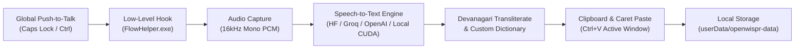

# Open Wispr

<div align="center">
  
  <br />
  <strong>Clean-room open-source speech-to-text dictation desktop application.</strong>
  <p>Authentic warm-stone aesthetic • Zero logins • No subscriptions • Free Hugging Face Whisper & Local CUDA</p>
</div>

---

## Overview

**Open Wispr** is an independent, clean-room open-source desktop application that provides universal voice dictation into any desktop application. Hold your global hotkey (`Caps Lock` by default, or configurable `Ctrl` in settings), speak into your microphone, and your words are instantly transcribed and pasted directly into your active text field.

The entire UI is crafted to match the authentic, warm-neutral "stone & cream" aesthetic (`#F8F8F6`, `#F2F1ED`, `#1A1917`, EB Garamond serif titles, Figtree typography).

### Key Architectural Principles
- **Zero Login / Zero Paywall**: All accounts, OAuth, WorkOS, Stripe billing, and paywalls from the original proprietary software have been completely removed. The app opens directly to the dashboard on first launch with zero telemetry and zero cloud lock-in.
- **Centralized Branding**: All application names, window titles, product labels, and tray tooltips are isolated in a single file ([`src/shared/branding.ts`](src/shared/branding.ts)).
- **Free Cloud & Local Speech-to-Text**:
  - **Hugging Face Inference (Default)**: Free `openai/whisper-large-v3-turbo` model via Hugging Face Router API (`https://router.huggingface.co/hf-inference/models/...`).
  - **Groq Whisper**: Blazing-fast cloud Whisper inference.
  - **OpenAI Whisper**: Standard cloud API.
  - **Local Whisper CUDA Daemon**: Completely offline, private transcription running directly on your local GPU via PyTorch CUDA.
- **Low-Level Global Push-to-Talk & Caret Paste**: Powered by `bin/FlowHelper.exe` for low-level Windows keyboard hooking and automatic `Ctrl+V` clipboard pasting into any foreground application.

---

## Screens & Features

1. **Floating Flow Bar ("The Pill")**:
   - Transparent, frameless, draggable window (`alwaysOnTop: true`).
   - Dynamic 16-band RMS audio spectrum: resting breathing dots in silence, animated amber-gold wavebars when speaking.
   - Smooth state transitions: `Idle` -> `Recording` -> `Transcribing` -> `Pasted`.
2. **Main Hub Dashboard**:
   - **Timeline**: Past dictations grouped by TODAY and YESTERDAY, searchable, with one-click copy and bookmarking.
   - **Metrics & Voice Profile**: Words spoken, words per minute (WPM), streak days.
   - **Dictionary**: Custom jargon, technical terms, acronyms, and phonetic replacement rules.
   - **Snippets**: Quick trigger expansion (e.g. typing or saying `"my email"` expands to your full template).
   - **Style & AI Transforms**: Polish dictated text into Formal, Casual, Concise, or Bullet point format.
   - **Productivity Insights**: Speedometer gauge, vocabulary mastery, and activity heatmap.
3. **Scratchpad Window**:
   - Dedicated voice notes editor with auto-save, note management, and AI formatting.
4. **Notetaker / Meeting Recorder**:
   - Long-form audio recording with live visualizer, automatic transcription, executive summaries, and action item extraction.
5. **Transliteration Engine**:
   - Built-in Hindi/Devanagari to Roman script transliterator for Hinglish dictation.

---

## Quick Start

### Official Showcase & Live Demo
Visit the official web page: **[https://rajviyash9136freefr-tech.github.io/OpenWisprFlow/](https://rajviyash9136freefr-tech.github.io/OpenWisprFlow/)**

### Downloads by Platform (v2.0.0)
| Operating System | Package | Release Download Page |
| :--- | :--- | :--- |
| **Windows (11 & 10)** | Unified Setup Installer (.exe) | [Open.Wispr.Setup.2.0.0.Windows.exe](https://github.com/rajviyash9136freefr-tech/OpenWisprFlow/releases/tag/v2.0.0) |
| **macOS** | Universal App Bundle (.zip) | [Open-Wispr-2.0.0-Mac.zip](https://github.com/rajviyash9136freefr-tech/OpenWisprFlow/releases/tag/v2.0.0) |
| **Linux** | Complete x86-64 Bundle (.tar.gz) | [Open-Wispr-2.0.0-Linux.tar.gz](https://github.com/rajviyash9136freefr-tech/OpenWisprFlow/releases/tag/v2.0.0) |

*Full Release Details & Checksums: [GitHub Release v2.0.0](https://github.com/rajviyash9136freefr-tech/OpenWisprFlow/releases/tag/v2.0.0)*

### Cross-PC Compatibility Fixes (v1.0.7)
- **Universal Microphone Compatibility**: Eliminated hardware `sampleRate: 48000` constraints in `getUserMedia` that triggered `OverconstrainedError` on external USB headsets, Bluetooth mics, and 44.1kHz laptop sound cards.
- **Adaptive VAD Sensitivity**: Lowered voice activity threshold from 0.0006 to 0.00012 (-39 dBFS) and disabled silent-dropping so low-gain microphones and whisper dictations are preserved without "Speech too short" errors.
- **Helper Watchdog & Auto-Recovery**: Native C# hook helper now features exponential auto-restart watchdog on process interruption or Windows screen lock.
- **Ultra-Fast Direct Paste**: Added zero-latency VBScript direct paste fallback (<30ms) replacing high-overhead PowerShell spawning.
- **Global Shortcut Fallback**: Registered universal `F8` and `Ctrl+Space` fallback keys for environments where low-level Windows hooks are restricted by security policies.

### 1. Prerequisites
- **Node.js**: v18.0.0 or higher
- **npm** or **pnpm**
- Windows 10/11, macOS, or Linux

### 2. Installation
```bash
# Clone the repository
git clone https://github.com/rajviyash9136freefr-tech/OpenWisprFlow.git
cd OpenWisprFlow

# Install dependencies
npm install
```

### 3. Setting Up Free Hugging Face Whisper
1. Get a free Hugging Face User Access Token at [huggingface.co/settings/tokens](https://huggingface.co/settings/tokens).
2. Create a `.env` file from the example:
   ```bash
   cp .env.example .env
   ```
3. Add your token:
   ```env
   HF_TOKEN=hf_your_free_token_here
   HF_MODEL=openai/whisper-large-v3-turbo
   ```
   *(Alternatively, launch the app and paste your token directly into **Settings ➔ Providers**).*

### 4. Running the App
```bash
# Start Vite development server and Electron
npm run dev
```

### 5. Building the Installer
```bash
# Compile and package for Windows (.exe installer + portable)
npm run package
```

---

## How It Works



---

## Project Structure

```
wispr-clone/
├── assets/
│   └── logo.svg                # Original Open Wispr soundwave-microphone logo
├── bin/
│   └── FlowHelper.exe          # Native low-level keyboard hook & paste injector
├── src/
│   ├── main/
│   │   ├── index.ts            # Electron backend, tray, IPC mesh
│   │   ├── windows/
│   │   │   └── WindowManager.ts# Hub, Overlay, Scratchpad & Meeting window lifecycle
│   │   └── services/
│   │       ├── StorageService.ts       # Local JSON state storage
│   │       ├── TranscriptionService.ts # Cascading STT providers & AI polish
│   │       ├── LocalWhisperService.ts  # PyTorch CUDA Whisper IPC daemon
│   │       ├── NativeHelperService.ts  # C++ helper process communication
│   │       └── transliterate.ts        # Hindi/Devanagari to Hinglish transliteration
│   ├── preload/
│   │   └── index.ts            # Secure contextBridge (window.electron, window.zubridge)
│   ├── shared/
│   │   ├── branding.ts         # Central branding definitions
│   │   └── types.ts            # Common TypeScript interfaces
│   └── renderer/
│       ├── App.tsx             # Window router
│       ├── main.tsx            # React 18 entrypoint
│       ├── store/
│       │   └── useStore.ts     # Zustand client-side state
│       ├── services/
│       │   ├── audioRecorder.ts# 16kHz Web Audio PCM recorder & RMS spectrum
│       │   └── soundEffects.ts # Zero-latency sound feedback cues
│       ├── styles/
│       │   └── index.css       # Tailwind CSS & custom scrollbars
│       ├── components/
│       │   ├── Sidebar.tsx     # Navigation sidebar
│       │   ├── SettingsModal.tsx # Full settings dialog (No login)
│       │   └── OpenWisprLogo.tsx # Vector branding component
│       └── windows/
│           ├── HubWindow.tsx   # Dashboard, Dictionary, Snippets, Style, Insights
│           ├── OverlayWindow.tsx # Floating Flow Bar
│           ├── ScratchpadWindow.tsx # Voice notes editor
│           └── MeetingWindow.tsx # AI meeting recorder
├── package.json
├── vite.config.ts
├── tailwind.config.js
└── README.md
```

---

## License

This project is licensed under the [MIT License](LICENSE).
Open Wispr is an independent, clean-room open-source project. Not affiliated with or endorsed by Wispr AI.
