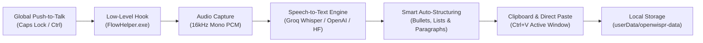

# Open Wispr

<div align="center">
  
  <br />
  <strong>Clean-room open-source speech-to-text dictation desktop application.</strong>
  <p>Authentic warm-stone aesthetic • Zero logins • 100% Free Forever • Ultra-Fast Groq Whisper & Smart Auto-Structuring</p>
</div>

---

## Overview

**Open Wispr** is an independent, clean-room open-source desktop application that provides universal voice dictation into any desktop application. Hold your global hotkey (`Caps Lock` by default, or configurable in settings), speak into your microphone, and your words are instantly transcribed, auto-organized, and pasted directly into your active text field.

The entire UI is crafted to match the authentic, warm-neutral "stone & cream" aesthetic (`#F8F8F6`, `#F2F1ED`, `#1A1917`, EB Garamond serif titles, Figtree typography).

### Key Architectural Principles
- **Zero Login / Zero Paywall**: All accounts, OAuth, WorkOS, Stripe billing, and paywalls from the original proprietary software have been completely removed. The app opens directly to the dashboard with zero telemetry and zero cloud lock-in.
- **Interactive Onboarding Wizard**: First-time users are greeted with a guided 3-step setup to enter their name, grab a free Groq API key with one click, test latency, and start dictating immediately.
- **Ultra-Fast 200ms Whisper Large v3 Turbo**: Powered by Groq Cloud for instant, zero-lag voice dictation with flawless accuracy in English, Hindi, and Hinglish.
- **Wispr Smart Auto-Structuring**: Long rambles and spoken lists are automatically transformed into clean bullet points (`•`), numbered steps (`1., 2.`), and well-spaced paragraphs, with verbal fillers (`"uh"`, `"um"`, `"matlab"`, stutters) seamlessly removed.
- **Live Counters & Streaks**: Real-time total words counter, average speaking speed (WPM), day streak tracker with broken-streak detection, and total days active counter.
- **Anti-Tamper & Security Hardening**: Electron sandbox enabled, context isolation enforced, DevTools disabled in production, foreign URL navigation prevented, and packaged in a secured ASAR bundle.
- **Low-Level Global Push-to-Talk & Caret Paste**: Powered by `bin/FlowHelper.exe` for low-level Windows keyboard hooking and automatic `Ctrl+V` clipboard pasting into any foreground application.

---

## ⚡ Quick Setup Guide (Get Started in 60 Seconds)

Open Wispr uses Groq Cloud's free tier for ultra-fast Whisper speech recognition (14,400 free requests per day with zero billing required):

1. **Get Free Groq API Key**:
   - Open [Groq API Keys Console (console.groq.com/keys)](https://console.groq.com/keys).
   - Sign up or log in (100% free with Google or GitHub, no credit card required).
   - Click **"+ Create API Key"** and copy your key (starts with `gsk_...`).
2. **Launch Open Wispr**:
   - Open the app. The interactive Setup Wizard will automatically appear.
   - Enter your name.
   - Paste your `gsk_...` key and click **"Test Connection"** to verify latency.
   - Click **"Start Using Free Open Wispr"**!
3. **Dictate Anywhere**:
   - Hold down **`Caps Lock`** (or your custom shortcut) in any app (Word, VS Code, Browser, WhatsApp, Slack).
   - Speak naturally.
   - Release the key to instantly paste clean, formatted text!

---

## Screens & Features

1. **Floating Flow Bar ("The Pill")**:
   - Transparent, frameless, draggable floating pill (`alwaysOnTop: true`).
   - Dynamic 16-band RMS audio spectrum: resting breathing dots in silence, animated amber-gold wavebars when speaking.
   - Smooth state transitions: `Idle` -> `Recording` -> `Transcribing` -> `Done`.
2. **Main Hub Dashboard**:
   - **Timeline**: Past dictations grouped by date, searchable, with one-click copy, audio playback, and bookmarking.
   - **Metrics & Voice Profile**: Live total words count, speaking speed (WPM), day streak, and total days active.
   - **Dictionary**: Custom jargon, technical terms, acronyms, and phonetic replacement rules.
   - **Snippets**: Quick trigger expansion (e.g. typing or saying `"my email"` expands to your full template).
   - **Style & AI Transforms**: Polish dictated text into Formal, Casual, Concise, or Bullet point format.
   - **Productivity Insights**: Speedometer gauge, vocabulary mastery, and activity heatmap.
3. **Scratchpad Window**:
   - Dedicated voice notes editor with auto-save, note management, and AI formatting.
4. **Notetaker / Meeting Recorder**:
   - Long-form audio recording with live visualizer, automatic transcription, executive summaries, and action item extraction.
5. **Transliteration Engine**:
   - Built-in Hindi/Devanagari to Roman script transliterator for Hinglish dictation.

---

## Downloads (v2.0.0)

| Operating System | Package | Description |
| :--- | :--- | :--- |
| **Windows (11 & 10)** | [Open Wispr Setup 2.0.0.exe](https://github.com/rajviyash9136freefr-tech/OpenWisprFlow/releases/tag/v2.0.0) | Complete Windows NSIS Installer |
| **Windows Portable** | [Open Wispr Portable.exe](https://github.com/rajviyash9136freefr-tech/OpenWisprFlow/releases/tag/v2.0.0) | Standalone executable (no install required) |

Official Web Showcase: **[https://rajviyash9136freefr-tech.github.io/OpenWisprFlow/](https://rajviyash9136freefr-tech.github.io/OpenWisprFlow/)**

---

## Development & Building

### 1. Prerequisites
- **Node.js**: v18.0.0 or higher
- **npm** or **pnpm**
- Windows 10/11

### 2. Installation
```bash
# Clone the repository
git clone https://github.com/rajviyash9136freefr-tech/OpenWisprFlow.git
cd OpenWisprFlow

# Install dependencies
npm install
```

### 3. Running in Development
```bash
# Start Vite development server and Electron
npm run dev
```

### 4. Building the Production Installer
```bash
# Compile TypeScript and package into ASAR installer
npm run package
```

The compiled installer `Open Wispr Setup 2.0.0.exe` and portable binary will be generated in the `release/` directory.

---

## How It Works



---

## License

This project is licensed under the [MIT License](LICENSE).  
Open Wispr is an independent, clean-room open-source project. Not affiliated with or endorsed by Wispr AI.
